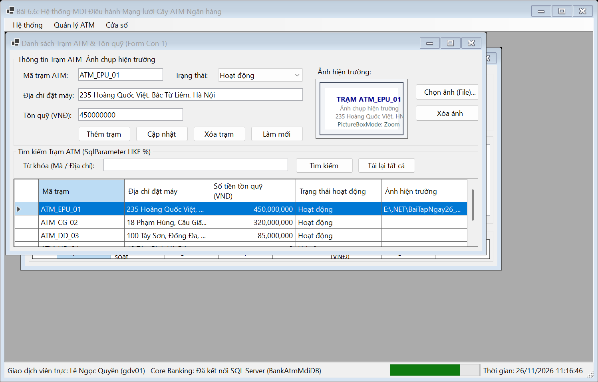
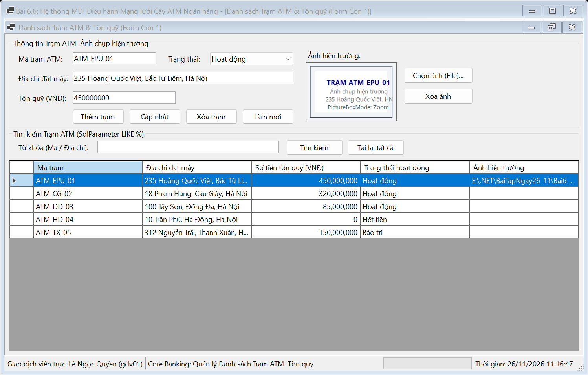
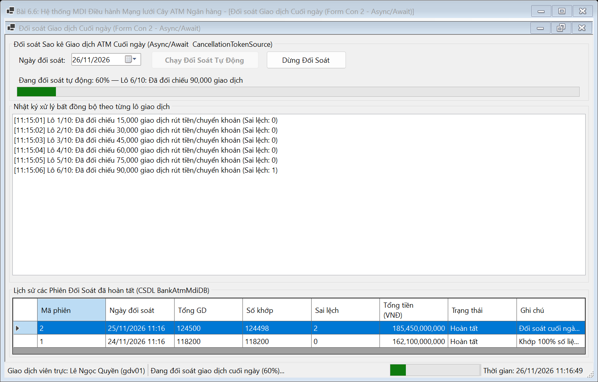
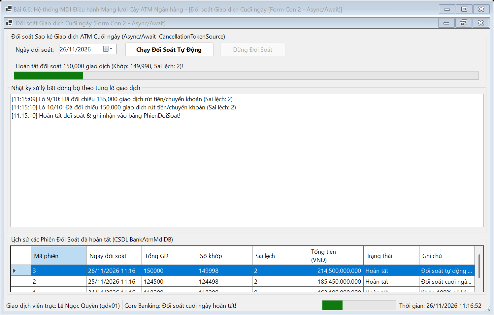
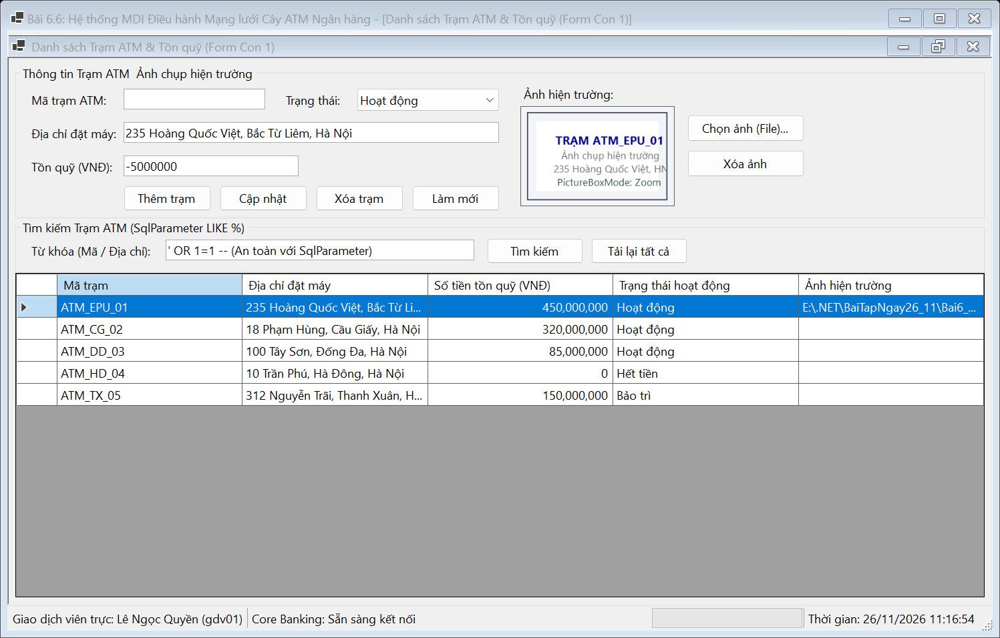

# BÀI TẬP 6.6: HỆ THỐNG MDI ĐIỀU HÀNH MẠNG LƯỚI CÂY ATM NGÂN HÀNG (KIẾN TRÚC MDI & ASYNC/AWAIT)

## MỤC 1: THÔNG TIN SINH VIÊN
- **Họ và tên sinh viên:** Lê Ngọc Quyền
- **Mã sinh viên:** 24810310259
- **Lớp / Khóa:** D19CNPM3
- **Môn học:** Lập trình .NET / Windows Forms (Kiến trúc 3-Tier, MDI & Async/Await)

---

## MÔ TẢ KIẾN TRÚC & TÍNH NĂNG
- **Kiến trúc chuẩn 3-Tier:** `DTO` $\rightarrow$ `DAL` $\rightarrow$ `BUS` $\rightarrow$ `GUI`.
- **CSDL SQL Server (`BankAtmMdiDB`):** Gồm 4 bảng (`GiaoDichVien`, `TramATM`, `GiaoDichATM`, `PhienDoiSoat`) trong [`Database/ScriptDB.sql`](./Database/ScriptDB.sql).
- **Form Cha MDI (`frmBankAtmMain`):** `IsMdiContainer = true`, `MenuStrip` gồm *Hệ thống* (Đăng xuất, Khóa màn hình, Thoát), *Quản lý ATM* (Danh sách Trạm ATM & Tồn quỹ, Đối soát Giao dịch Cuối ngày), *Cửa sổ* (Xếp tầng Cascade, Xếp ngang Tile Horizontal, Xếp dọc Tile Vertical, Đóng tất cả); `StatusStrip` hiển thị Giao dịch viên trực, trạng thái Core Banking và `ToolStripProgressBar`.
- **Ngăn mở trùng lặp Form Con:** Duyệt `this.MdiChildren`, nếu đã tồn tại thì gọi `Activate()`, ngược lại khởi tạo mới và gán `MdiParent = this`.
- **Form Con 1 (`frmAtmStations`):** CRUD Trạm ATM, tìm kiếm bằng `SqlParameter` (`LIKE %`), đính kèm ảnh hiện trường qua `OpenFileDialog` (`PictureBoxSizeMode.Zoom`), kiểm tra lỗi bằng `ErrorProvider`.
- **Form Con 2 (`frmAtmReconciliation`):** Xử lý đối soát bất đồng bộ bằng `async/await` + `Task.Run` + `Task.Delay` (~5 giây) + `CancellationTokenSource` (nút *Chạy Đối Soát Tự Động* và *Dừng Đối Soát*), đồng bộ tiến trình lên `ToolStripProgressBar` của Form cha mà không làm đơ giao diện.

---

## MỤC 2: HÌNH ẢNH KẾT QUẢ CÁC MÀN HÌNH CHỨC NĂNG

### 1. Màn hình Chính / Tổng quan hệ thống (MDI Parent & Form Con)

### 2. Màn hình Quản lý Danh mục (CRUD Trạm ATM & Đính kèm Ảnh hiện trường)

### 3. Màn hình Thực thi Nghiệp vụ chính (Đối soát Bất đồng bộ Async/Await & ToolStripProgressBar)

### 4. Màn hình Báo cáo - Thống kê (Hoàn tất Đối soát & Lịch sử Phiên)

### 5. Minh họa An toàn Dữ liệu (Kiểm tra hợp lệ ErrorProvider & Chống SQL Injection)

