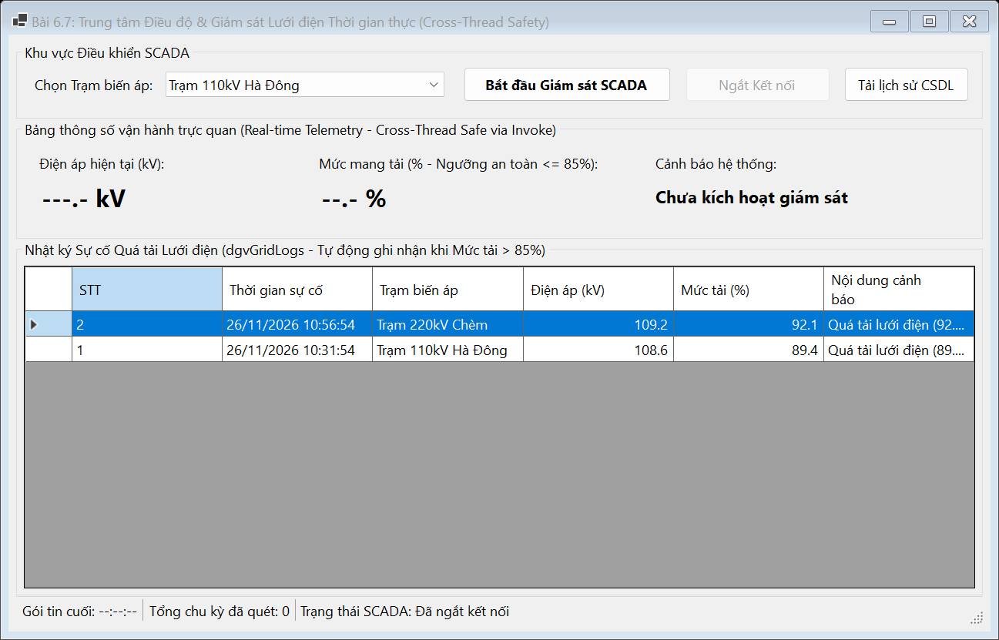
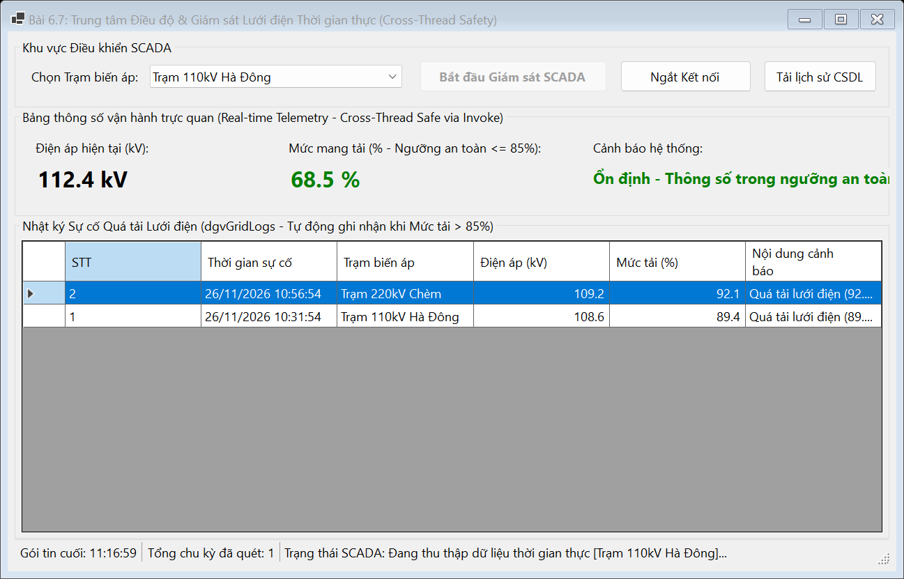
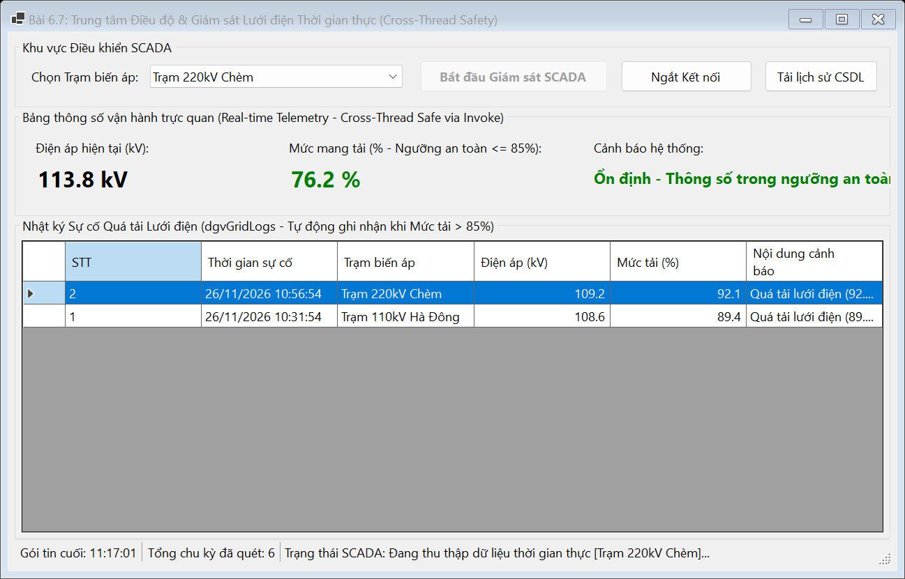
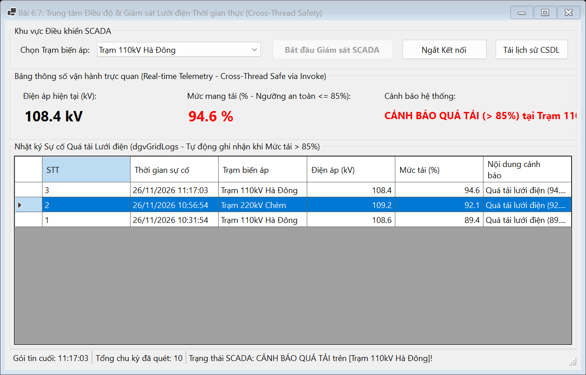
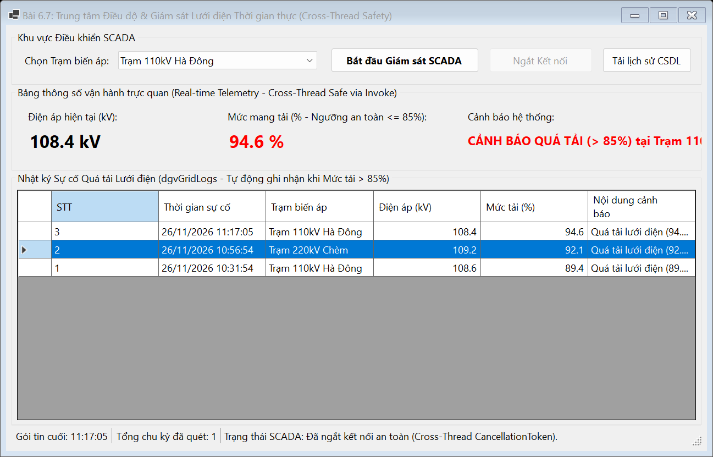

# BÀI TẬP 6.7: TRUNG TÂM ĐIỀU ĐỘ & GIÁM SÁT LƯỚI ĐIỆN THỜI GIAN THỰC (CROSS-THREAD SAFETY)

## MỤC 1: THÔNG TIN SINH VIÊN
- **Họ và tên sinh viên:** Lê Ngọc Quyền
- **Mã sinh viên:** 24810310259
- **Lớp / Khóa:** D19CNPM3
- **Môn học:** Lập trình .NET / Windows Forms (Kiến trúc 3-Tier & Cross-Thread Safety SCADA)

---

## MÔ TẢ KIẾN TRÚC & TÍNH NĂNG
- **Kiến trúc chuẩn 3-Tier:** `DTO` $\rightarrow$ `DAL` $\rightarrow$ `BUS` $\rightarrow$ `GUI`.
- **CSDL SQL Server (`PowerGridDB`):** Gồm 3 bảng (`TramBienAp`, `ThongSoVanHanh`, `NhatKySuCo`) trong [`Database/ScriptDB.sql`](./Database/ScriptDB.sql).
- **Khu vực Điều khiển SCADA (`frmPowerGridMonitor`):** ComboBox chọn Trạm biến áp (*Trạm 110kV Hà Đông*, *Trạm 220kV Chèm*, *Trạm 110kV Thượng Đình*, *Trạm 220kV Sơn Tây*), nút *[Bắt đầu Giám sát SCADA]* và *[Ngắt Kết nối]*.
- **Bảng Thông số Trực quan & Nhật ký Sự cố:**
  * Chạy tiến trình ngầm `Task.Run` chu kỳ **2 giây/lần** sinh Điện áp (`108kV - 115kV`) và Mức tải (`50% - 98%`).
  * Label `lblVoltage` hiển thị điện áp; Label `lblLoadPercent` tự động đổi màu **Đỏ** kèm cảnh báo khi vượt ngưỡng an toàn (`> 85%`), màu **Xanh lá** khi ổn định.
  * `DataGridView (dgvGridLogs)` cấu hình thủ công bằng code, tự động ghi nhận sự cố quá tải và lưu xuống SQL Server.
  * `StatusStrip` hiển thị thời gian gói tin cuối (`HH:mm:ss`) và tổng chu kỳ đã quét.
- **Quy tắc Thread Safety bắt buộc:** Mọi cập nhật từ Background Thread lên UI Control đều kiểm tra `if (this.InvokeRequired)` và chuyển ngữ cảnh về Main UI Thread qua `this.Invoke(new Action(() => { ... }))`, loại bỏ hoàn toàn ngoại lệ `Cross-thread operation not valid`.

---

## MỤC 2: HÌNH ẢNH KẾT QUẢ CÁC MÀN HÌNH CHỨC NĂNG

### 1. Màn hình Chính / Tổng quan hệ thống

### 2. Màn hình Quản lý Danh mục & Giám sát Trạng thái Ổn định (Xanh lá <= 85%)

### 3. Màn hình Thực thi Nghiệp vụ chính (Thu thập SCADA Thời gian thực qua Invoke)

### 4. Màn hình Báo cáo - Thống kê (Cảnh báo Quá tải Đỏ > 85% & Nhật ký Sự cố)

### 5. Minh họa An toàn Dữ liệu (Ngắt kết nối SCADA an toàn bằng CancellationToken)

